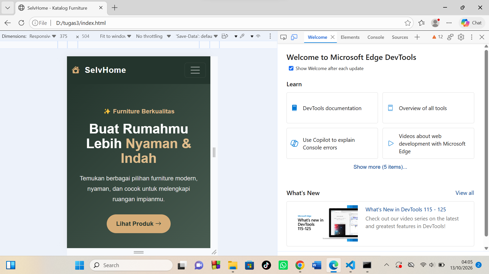
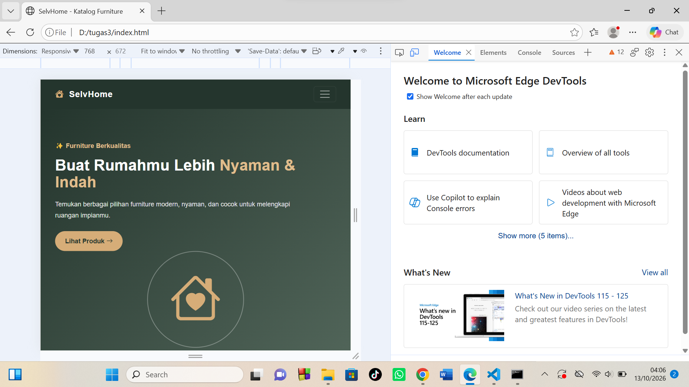
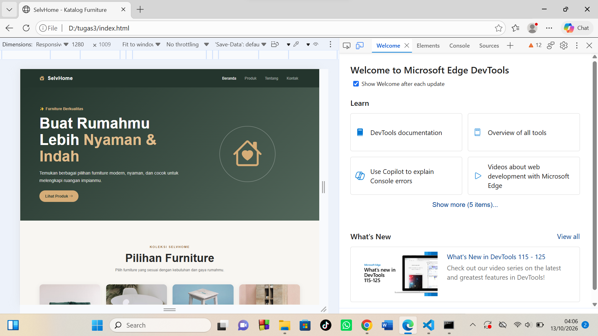

# SelvHome — Katalog Produk Responsif

Halaman katalog produk furniture responsif bernama **SelvHome**, dibuat menggunakan
Bootstrap untuk mata kuliah Pemrograman Web, UNIMED (Tugas Rutin 3).

## Fitur
- Pendekatan mobile-first
- Minimal 3 breakpoint (mobile, tablet, desktop)
- Grid produk responsif (1 → 2 → 3/4 kolom)
- Navbar responsif dengan hamburger menu di mobile
- Card produk (gambar, info, harga, tombol)
- Responsive images
- Typography fluid menggunakan `clamp()`
- Footer

## Struktur Folder
- `index.html` — halaman utama
- `style.css` — styling halaman
- `script.js` — interaksi halaman

## Dokumentasi Testing
Pengujian tampilan dilakukan menggunakan fitur device mode di browser DevTools
pada tiga ukuran layar.

| Breakpoint | Lebar | Screenshot |
|---|---|---|
| Mobile | 375 px |  |
| Tablet | 768 px |  |
| Desktop | 1280 px |  |

## Cara Menjalankan
1. Clone repo ini
2. Buka file `index.html` di browser

## Pembuat
Selvira
